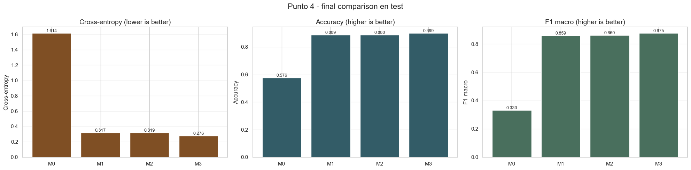

# Reconocimiento de caracteres manuscritos · Redes neuronales

Trabajo práctico individual de **I302 — Aprendizaje Automático y Aprendizaje Profundo**,
Universidad de San Andrés, primer semestre de 2026. **Autor: Tomás González.**

MLP implementado con NumPy, mejoras del entrenamiento y comparación con redes en
PyTorch sobre **EMNIST ByMerge**: 809.555 imágenes de 28 × 28 píxeles y 47 clases.



## Documentación y versiones

- [Consigna original](docs/consigna.pdf).
- [Notebook de la versión previamente publicada](Entrega_TP3.ipynb).
- [Notebook de la entrega recibida en ZIP](entrega_original/Entrega_TP3.ipynb).
- [README de esa entrega](entrega_original/README.md), incluida su declaración sobre
  asistencia de IA en gráficos y presentación.
- [README previo del repositorio](docs/README_repositorio_previo.md).

Este repositorio ya existía al incorporar los archivos de la entrega. Se conserva
su historial y el código de la raíz; la versión del ZIP se guarda sin modificaciones
en `entrega_original/`, porque contiene diferencias respecto de lo publicado.
Para analizar una versión, usar su notebook, código y artifacts en conjunto.
La metadata `.git` incluida en el ZIP se excluyó de la copia archivada.

## Dataset original

[Descargar I302_ML_TP3_datasets.zip desde la release](https://github.com/TomaasGonzalezzz/TP3_Machine_Learning/releases/download/tp3-datasets-2026/I302_ML_TP3_datasets.zip)

El ZIP original pesa aproximadamente **205 MB** y contiene `X_images.npy`,
`y_images.npy` y `X_COMP.npy`. La matriz de imágenes ocupa unos 635 MB sin comprimir;
los datos se distribuyen como adjunto de release, fuera del historial Git.

1. Descargar y extraer el ZIP.
2. Copiar `X_images.npy` y `y_images.npy` desde su carpeta interna a `Datasets/`.
3. Para ejecutar la versión archivada, colocarlos en `entrega_original/Datasets/`.
   `X_COMP.npy` también se conserva en el ZIP; el cargador principal utiliza los otros dos.

Los datos provienen del material de la cátedra. Los hashes SHA-256 del ZIP y de
los tres arrays están en [docs/procedencia.json](docs/procedencia.json).
`Datasets/` está excluida de Git para evitar agregar los archivos pesados.

## Recorrido del trabajo

1. Analizar las imágenes y clases, dividir en train/validation/test y normalizar píxeles.
2. Implementar un MLP con ReLU, softmax, cross-entropy y backpropagation: baseline **M0**.
3. Incorporar mini-batches, schedules, Adam, L2 y early stopping; seleccionar **M1**.
4. Replicar la arquitectura de M1 en PyTorch para obtener **M2**.
5. Explorar activaciones, BatchNorm, Dropout y arquitecturas PyTorch para seleccionar **M3**.
6. Comparar los cuatro modelos en test y evaluar su degradación ante ruido gaussiano.

En la entrega recibida, el split estratificado contiene **566.667 imágenes de train,
121.410 de validation y 121.478 de test**. M1 y M2 utilizan la arquitectura
`784 → 512 → 256 → 128 → 47`.

## Resultados guardados de la entrega

La tabla `entrega_original/artifacts/point4_test_summary.csv` reporta:

| Modelo | Cross-entropy test | Accuracy test | F1 macro test |
| --- | ---: | ---: | ---: |
| M0 · NumPy base | 1,6139 | 0,5762 | 0,3328 |
| M1 · NumPy mejorado | 0,3168 | 0,8888 | 0,8586 |
| M2 · PyTorch equivalente | 0,3192 | 0,8879 | 0,8605 |
| M3 · PyTorch seleccionado | 0,2763 | 0,8993 | 0,8753 |

Son resultados originales guardados, no de un reentrenamiento realizado al completar
el repositorio. La comparación muestra resultados cercanos entre M1 y M2, y una
mejora con la arquitectura y regularización seleccionadas para M3.

## Código y resultados

| Ruta | Función |
| --- | --- |
| `src/data.py` | Carga de arrays y split estratificado. |
| `src/models.py`, `src/training.py` | MLP y entrenamiento NumPy. |
| `src/experiments.py` | Experimentos y selección de modelos NumPy. |
| `src/torch_models.py`, `src/torch_training.py`, `src/torch_experiments.py` | Redes, entrenamiento y experimentos PyTorch. |
| `src/metrics.py`, `src/plots.py` | Métricas y gráficos. |
| `artifacts/` | Historiales, métricas, tablas y parámetros NumPy ya calculados. |
| `scripts/run_point4_artifacts.py` | Regeneración de resultados del punto 4. |
| `entrega_original/` | Copia de la entrega del ZIP, con su propia estructura equivalente. |

Los artifacts compactos permiten revisar resultados sin repetir entrenamientos
largos. La entrega contiene parámetros de M0/M1; no incluye checkpoints completos
PyTorch de M2/M3. Para regenerar sus predicciones se requiere reentrenarlos.

## Instalar y abrir

El notebook del ZIP registra **Python 3.14.3**. La entrega incluye versiones exactas
de las dependencias en su `requirements.txt`, incluida una compilación CPU de PyTorch.
Se conservaron esas especificaciones sin modificarlas. No se verificó una instalación
completa de ese entorno durante esta publicación.

Desde la carpeta de la versión elegida —raíz del repositorio o `entrega_original/`—:

```sh
python -m venv .venv
```

Activar el entorno:

```powershell
# Windows PowerShell
.\.venv\Scripts\Activate.ps1
```

```sh
# macOS / Linux
source .venv/bin/activate
```

Instalar y abrir el notebook:

```sh
python -m pip install -r requirements.txt
python -m notebook Entrega_TP3.ipynb
```

Mantener `Datasets/`, `src/` y `artifacts/` junto al notebook de la versión elegida.
Las salidas guardadas pueden leerse sin ejecución; ejecutar las celdas de carga sí
requiere el dataset. Los flags de reentrenamiento y los comandos originales están
en el README de cada versión. Recalcular los experimentos puede tardar y reescribe
artifacts; conviene hacerlo en una copia o rama.

## Verificación y conservación

Se conservaron los 29 archivos de trabajo del ZIP, junto con la consigna y el ZIP
original del dataset en la release. Se añadieron documentación, procedencia y
una figura extraída de una salida guardada del notebook.

Se comprobó la sintaxis del código de la entrega, la carga segura de los arrays,
la cobertura y separación del split y que los parámetros NumPy guardados fueran
finitos. El gradiente de backpropagation se contrastó con diferencias finitas en
una red sintética pequeña, con error absoluto máximo inferior a `1e-9`.
El [registro de verificación](docs/verificacion_basica.json) detalla alcance y entorno.
No se repitieron entrenamientos de EMNIST ni ejecuciones PyTorch.

Se mantienen la autoría y la declaración original sobre asistencia en gráficos.
No se incorpora una licencia adicional sobre los materiales del estudiante o la cátedra.
